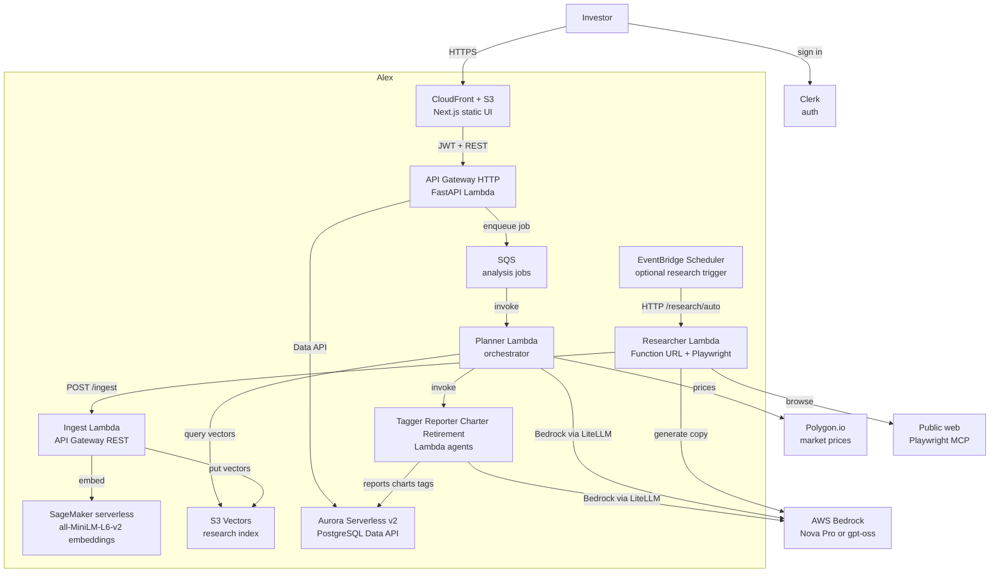
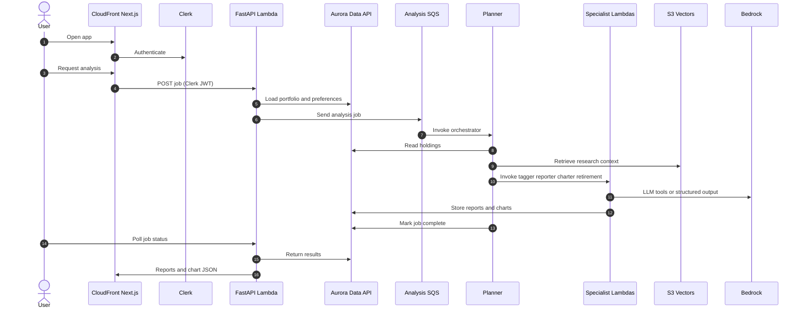
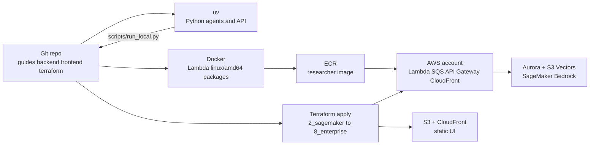

# Alex

**Agentic Learning Equities eXplainer** is a multi-agent SaaS for portfolio analysis: reports, charts, retirement projections, and market research on AWS.

## Credit

This project is based on **[Alex](https://github.com/ed-donner/alex)** by **[Ed Donner](https://github.com/ed-donner)**, the capstone for Weeks 3 and 4 of the Udemy course [AI in Production](https://www.udemy.com/). Original copyright is Ed Donner's (see [LICENSE](LICENSE)). This repository is a student snapshot of that work, with local deployment changes (including the researcher running as a Lambda container image with a Function URL).

Course questions and contributions belong with Ed: [ed-donner/alex](https://github.com/ed-donner/alex) or ed@edwarddonner.com.

## What it does

Signed-in users manage holdings in a Next.js app (Clerk). The FastAPI backend enqueues an analysis job. A **Planner** Lambda orchestrates **Tagger**, **Reporter**, **Charter**, and **Retirement** agents (OpenAI Agents SDK, Bedrock). A separate **Researcher** agent browses the web on a schedule, embeds documents, and stores vectors so later analyses can pull market context.

Infrastructure is split into independent Terraform directories (`terraform/2_sagemaker` through `terraform/8_enterprise`) with local state. Step-by-step deploy notes are in `guides/`.

## Architecture components

C4 container view of production. Internals sit inside the Alex boundary; people and vendors sit outside.

## Request path

Portfolio analysis from the browser through the agent orchestra.

## Deployment

Each `terraform/*` folder is applied on its own (local `terraform.tfstate`, no shared remote backend). Lambda zip/image packages are built with Docker; the frontend is a Next.js static export uploaded to S3 and served by CloudFront.

Apply order matches the guides: SageMaker embeddings, ingest + S3 Vectors, researcher, Aurora, agent Lambdas + SQS, frontend + API, then optional CloudWatch/Langfuse in enterprise.

## Repository layout

| Path | Role |
|------|------|
| `guides/` | Deploy walkthroughs (start here) |
| `backend/` | Planner, tagger, reporter, charter, retirement, researcher, ingest, API, shared database lib |
| `frontend/` | Next.js Pages Router + Clerk |
| `terraform/` | Independent stacks per guide |
| `scripts/` | Local run, frontend deploy, destroy helpers |

## License

MIT. Copyright (c) 2025 Ed Donner. See [LICENSE](LICENSE).
